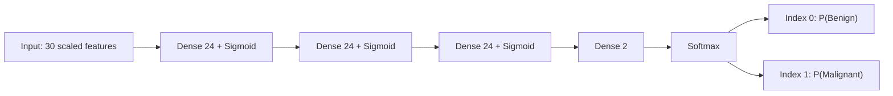

# Multilayer Perceptron


A **42 School project** implementing a feedforward neural network **from scratch using Python and NumPy** to classify breast cancer diagnoses. Dense layers, activation derivatives, backpropagation, losses, SGD, and Adam are implemented explicitly, with a command-line workflow for preparing data, training models, and evaluating predictions.

## Overview

A Multilayer Perceptron (MLP) connects an input vector to an output through fully connected layers. Each layer learns a weighted transformation; nonlinear activations let successive layers represent relationships beyond a single linear decision boundary.

This project maps 30 numerical measurements of cell nuclei to two probabilities: **benign** and **malignant**. The class with the higher probability becomes the prediction. Training adjusts the weights to reduce the discrepancy between predicted probabilities and known diagnoses.

Implementing these operations manually, without TensorFlow, PyTorch, or automatic differentiation, makes the learning process inspectable. The main educational objectives are understanding matrix dimensions, applying the chain rule, managing numerical stability, comparing optimization algorithms, and separating model fitting from validation and evaluation.

## Features

- Configurable Dense networks with at least two hidden layers through the CLI.
- Sigmoid, Tanh, ReLU, and Linear hidden activations; a fixed two-neuron Softmax output.
- Random normal, Xavier normal, and He normal weight initialization.
- Vectorized forward propagation and explicit backward propagation.
- Shuffled mini-batches with SGD or Adam; optional sequential training of both optimizers for comparison.
- Categorical cross-entropy training and binary cross-entropy prediction evaluation.
- Additional MSE and Huber losses in the reusable `nn` library.
- Custom RobustScaler preprocessing, training/validation splitting, and one-hot labels. StandardScaler and MinMaxScaler are also implemented as library utilities; the CLI uses RobustScaler.
- Validation-based early stopping with restoration of saved best weights.
- Pickle serialization of the network and fitted scaler.
- Accuracy, precision, recall, F1, and loss reporting, plus learning curves for both data subsets.
- Unit and integration tests, including finite-difference checks of activation and loss gradients.

## Installation

Use **Python 3.10 or newer**: the source uses union annotations such as `Array | None`. Git and Python's `venv` module are needed for the following shell commands.

```bash
git clone https://github.com/khalil-sohail/Multilayer-Perceptron.git
cd Multilayer-Perceptron
python3 -m venv .venv
source .venv/bin/activate
python -m pip install numpy pandas matplotlib
python main.py phase=process dataset=data/data.csv
```

NumPy provides numerical arrays, pandas reads and writes CSV files, and Matplotlib displays learning curves. There is no dependency manifest or lockfile in the repository, so dependencies are installed explicitly and versions are not pinned. The commands below assume the virtual environment is active and the current directory is the repository root.

## Usage

The CLI accepts **`key=value` arguments**, not `--flags`. Unknown keys, duplicate keys, and missing required arguments are rejected. Supported phases are `process`, `train`, and `predict`; invoking `python main.py` without arguments prints an error and usage information.

### 1. Process the dataset

```bash
python main.py phase=process dataset=data/data.csv
```

This shuffles and splits the raw CSV, writing these files in the current directory:

| File | Contents for the bundled dataset |
| --- | --- |
| `data_training.csv` | 456 training rows |
| `data_validation.csv` | 113 validation rows |

Both retain the original 32-column, headerless format. **Scaling occurs during training**, not in this phase. The split uses `test_size=0.2` and seed `42`; these settings and the output filenames are fixed in `main.py`, with no CLI overrides.

### 2. Train

Train with SGD:

```bash
python main.py phase=train \
  dataset=data_training.csv validation=data_validation.csv \
  optimizer=sgd layers=24,24,24 activation=sigmoid initializer=xavier \
  epochs=84 batch_size=8 learning_rate_sgd=0.0314
```

Train with Adam:

```bash
python main.py phase=train \
  dataset=data_training.csv validation=data_validation.csv \
  optimizer=adam layers=24,24,24 activation=sigmoid initializer=xavier \
  epochs=84 batch_size=8 learning_rate_adam=0.001
```

Train both and display their learning curves together:

```bash
python main.py phase=train \
  dataset=data_training.csv validation=data_validation.csv \
  optimizer=both learning_rate_sgd=0.0314 learning_rate_adam=0.001
```

Use a custom architecture and separate artifact names:

```bash
python main.py phase=train \
  dataset=data_training.csv validation=data_validation.csv \
  optimizer=adam layers=64,32,16 activation=relu initializer=he \
  epochs=150 batch_size=16 learning_rate_adam=0.001 \
  model=custom.model scaler=custom.scaler
```

The last example creates `adam_custom.model` and `adam_custom.scaler`.

| Training argument | Default | Meaning / accepted values |
| --- | --- | --- |
| `dataset` | Required | Headerless training CSV |
| `validation` | Required | Headerless validation CSV |
| `layers` | `24,24,24` | Comma-separated positive hidden widths; at least two |
| `activation` | `sigmoid` | `relu`, `sigmoid`, `tanh`, or `linear`, applied after every hidden Dense layer |
| `initializer` | `xavier` | `random`, `xavier`, or `he`, used for every Dense layer including the output |
| `optimizer` | `both` | `sgd`, `adam`, or `both` |
| `epochs` | `84` | Positive integer; maximum number of epochs |
| `batch_size` | `8` | Positive integer; samples per parameter update |
| `learning_rate_sgd` | `0.0314` | Positive SGD step size |
| `learning_rate_adam` | `0.001` | Positive Adam base learning rate |
| `model` | `breast_cancer.model` | Model output basename before optimizer prefix |
| `scaler` | `breast_cancer.scaler` | Scaler output basename before optimizer prefix |

Activation, initializer, and optimizer values are case-insensitive. Softmax is fixed at the output and is not accepted as a hidden `activation` option. Loss, early-stopping settings, Adam's moment parameters, and random seeds are not configurable through this CLI.

**Artifact naming:** training prepends `sgd_` or `adam_` to the entire supplied model/scaler string. Use basenames as above; nested or absolute output paths are not handled as directory-aware names. Repeating a run with the same names overwrites its artifacts.

### 3. Predict and evaluate

After training both optimizers with default artifact names:

```bash
python main.py phase=predict dataset=data_validation.csv \
  model=sgd_breast_cancer.model scaler=sgd_breast_cancer.scaler

python main.py phase=predict dataset=data_validation.csv \
  model=adam_breast_cancer.model scaler=adam_breast_cancer.scaler
```

Prediction requires a **labeled CSV** in the same format as training data. It prints each row's predicted and true `B`/`M` label and whether they match, followed by `Loss`, `Accuracy`, `Precision`, `Recall`, and `F1 score` to six decimal places. The printed `Loss` is **binary cross-entropy (BCE)**.

The prediction phase accepts only `phase`, `dataset`, `model`, and `scaler`. Its default artifact names are the unprefixed `breast_cancer.model` and `breast_cancer.scaler`, so explicitly provide the filenames produced by training. Always pair a model with its saved scaler.

At the Python API level, `Sequential.predict(X)` returns an `(N, 2)` probability array and `predict_classes(X)` returns class indices. `BreastCancerPredictor.predict()` returns both arrays after preprocessing; the CLI prints labels rather than probability vectors and does not export a prediction CSV.

These examples re-evaluate validation data. They do **not** constitute an independent test-set evaluation.

## Dataset and Preprocessing

The bundled [data/data.csv](data/data.csv) contains the Wisconsin Diagnostic Breast Cancer dataset: **569 rows**, with **357 benign** and **212 malignant** labels. Its 30 features describe cell nuclei measured from digitized fine-needle aspirate images. See the [official UCI dataset description](https://archive.ics.uci.edu/dataset/17/breast+cancer+wisconsin+diagnostic).

Each row has 32 comma-separated fields and no header:

```text
id,diagnosis,30 numerical features
```

The first ten features are the means of radius, texture, perimeter, area, smoothness, compactness, concavity, concave points, symmetry, and fractal dimension. The next ten are their standard errors (`_se`), followed by ten worst-value measurements (`_worst`), in the same order. Exact column names are defined in [application/utils.py](application/utils.py).

The pipeline:

1. Loads the CSV with fixed column names and splits complete rows after a seeded shuffle. The validation count is `int(0.2 * number_of_rows)`; the split is **not stratified**.
2. Removes `id` and `diagnosis` from the input and converts the 30 measurements to `float64`.
3. Encodes `B` as class `0`, `[1, 0]`, and `M` as class `1`, `[0, 1]`.
4. Fits RobustScaler on **training features only**, then transforms training and validation features using those statistics.
5. Saves the fitted scaler and reuses it during prediction, without refitting.

For each feature, the default transformation is:

$$
x_{\mathrm{scaled}} = \frac{x - \mathrm{median}_{\mathrm{train}}}{Q_{75,\mathrm{train}} - Q_{25,\mathrm{train}}}
$$

Scaling reduces differences in magnitude between measurements such as area and smoothness, improving the conditioning of gradient updates. Median and interquartile-range statistics are less sensitive to extreme values than mean and standard deviation. Fitting them only on training data prevents validation information from entering preprocessing.

The bundled data has no missing entries. The loader does not impute missing values, remove duplicates or outliers, or validate diagnosis labels: the encoder treats every label other than `M` as class `0`. Supply clean data with exactly the expected columns and `B`/`M` labels. The default RobustScaler also does not guard against division by zero for a feature with zero IQR.

## Neural Network Architecture

The application fixes the input width at **30** and output width at **2**. `layers` specifies only hidden widths; the selected activation is instantiated separately after each hidden Dense layer. With the defaults, the architecture is `30 → 24 → 24 → 24 → 2`:



A Dense layer computes:

$$
Z = XW + b
$$

For a batch of $N$ samples, $X$ has shape $(N, d_{\mathrm{in}})$, weights $W$ have shape $(d_{\mathrm{in}}, d_{\mathrm{out}})$, and biases $b$ have shape $(1, d_{\mathrm{out}})$. NumPy broadcasts the bias across rows, producing $(N, d_{\mathrm{out}})$. That output width becomes the next layer's input width. The default weight matrices therefore have shapes `(30, 24)`, `(24, 24)`, `(24, 24)`, and `(24, 2)`; all biases start at zero.

## Mathematical Foundations

### Forward propagation and activations

Starting with $A^{(0)} = X$, each Dense/activation pair computes:

$$
Z^{(l)} = A^{(l-1)}W^{(l)} + b^{(l)}, \qquad
A^{(l)} = f(Z^{(l)})
$$

| Hidden activation | Forward function | Local derivative |
| --- | --- | --- |
| Sigmoid | $\sigma(z)=1/(1+e^{-z})$ | $\sigma(z)(1-\sigma(z))$ |
| Tanh | $\tanh(z)$ | $1-\tanh^2(z)$ |
| ReLU | $\max(0,z)$ | $1$ for $z>0$, otherwise $0$ |
| Linear | $z$ | $1$ |

Linear hidden layers are supported, but stacking only linear transformations does not add nonlinear representational power.

The output Softmax converts logits to a distribution over the two classes:

$$
p_i = \frac{e^{z_i}}{\sum_j e^{z_j}}
$$

The implementation subtracts the largest logit in each row before exponentiating. This leaves the probabilities unchanged while avoiding overflow from large positive logits.

### Initialization

Weights are sampled from zero-mean normal distributions:

| CLI option | Standard deviation | Typical pairing |
| --- | --- | --- |
| `random` | $0.2$ | Simple fixed-scale baseline |
| `xavier` | $\sqrt{2/(d_{\mathrm{in}}+d_{\mathrm{out}})}$ | Sigmoid or Tanh |
| `he` | $\sqrt{2/d_{\mathrm{in}}}$ | ReLU |

The initializer controls the starting scale of activations and gradients. The application applies the chosen strategy to the output Dense layer as well.

### Cross-entropy and backpropagation

Training uses mean categorical cross-entropy (CCE) over a batch of $N$ examples and $C=2$ classes:

$$
L = -\frac{1}{N}\sum_{n=1}^{N}\sum_{i=1}^{C} y_{ni}\ln(p_{ni})
$$

The loss clips probabilities to $[10^{-7}, 1-10^{-7}]$ before taking logarithms. Its backward pass returns $-Y/(N\widetilde{P})$, where $\widetilde{P}$ is the clipped probability array.

Backpropagation applies the chain rule by visiting layers in reverse order. For a single Softmax row with upstream gradient $g_i=\partial L/\partial p_i$, the implementation computes the full Jacobian-vector product efficiently:

$$
\frac{\partial L}{\partial z_i}
= p_i\left(g_i-\sum_j g_jp_j\right)
$$

This includes interactions between output classes. It is not an elementwise sigmoid derivative. Combining Softmax with CCE gives the familiar simplification:

$$
\frac{\partial L}{\partial Z} = \frac{P-Y}{N}
$$

The division by $N$ assumes **mean loss over the batch** and normalized target rows, as provided by one-hot encoding. The code uses separate CCE and Softmax backward passes rather than a fused shortcut. The simplification holds when clipping is inactive; at clipped extremes the implemented gradient can differ. The loss backward pass uses clipped denominators without differentiating the clipping operation itself.

For a Dense layer receiving $G=\partial L/\partial Z$:

$$
\frac{\partial L}{\partial W}=X^\top G, \qquad
\frac{\partial L}{\partial b}=\sum_{n=1}^{N}G_{n,:}, \qquad
\frac{\partial L}{\partial X}=GW^\top
$$

Dense layers **do not average again**: batch normalization of the gradient has already happened in the loss.

For prediction evaluation, BCE averages over all $NC$ entries of the two-column output:

$$
L_{\mathrm{BCE}}=-\frac{1}{NC}\sum_{n,i}
\left[y_{ni}\ln(p_{ni})+(1-y_{ni})\ln(1-p_{ni})\right]
$$

BCE uses the same clipping bounds and divides its gradient by the total number of prediction entries. With two complementary Softmax probabilities and one-hot targets, this mean BCE equals CCE mathematically, up to numerical effects. The library's MSE and Huber losses also average over all entries; their gradients use that same element count. Huber defaults to a quadratic-to-linear transition at `delta=1.0`.

### SGD and Adam updates

SGD applies the current gradient directly to each weight and bias:

$$
w_{t+1}=w_t-\eta g_t
$$

This implementation has no momentum or learning-rate schedule.

Adam maintains exponential moving averages of the gradient and its square:

$$
m_t=\beta_1m_{t-1}+(1-\beta_1)g_t, \qquad
v_t=\beta_2v_{t-1}+(1-\beta_2)g_t^2
$$

Because both estimates start at zero, it corrects their initial bias before updating parameters:

$$
\widehat m_t=\frac{m_t}{1-\beta_1^t}, \qquad
\widehat v_t=\frac{v_t}{1-\beta_2^t}, \qquad
w_{t+1}=w_t-\eta\frac{\widehat m_t}{\sqrt{\widehat v_t}+\epsilon}
$$

The code stores separate moment arrays for weights and biases, with a step counter per trainable layer. CLI training uses `beta1=0.9`, `beta2=0.999`, and `epsilon=1e-8`. Each layer is updated once per mini-batch. These equations follow [Kingma and Ba's Adam method](https://arxiv.org/abs/1412.6980).

## Training and Evaluation

### Epochs, mini-batches, and metrics

An epoch processes every training sample once, in a newly shuffled order. Each mini-batch performs a forward pass, computes loss, backpropagates gradients, and updates all trainable layers. A final partial batch is included.

The history distinguishes measurements taken at different times:

| Quantity | Calculation |
| --- | --- |
| Training loss | Sample-weighted average of mini-batch CCE values measured before each batch's update; weights change during the epoch |
| Training classification metrics | A fresh pass over the entire training set using weights at the end of the epoch |
| Validation loss and metrics | A pass over the entire validation set at the end of the epoch, without parameter updates |
| Prediction loss and metrics | Evaluation of the loaded model and scaler on the supplied labeled CSV; the application reports BCE |

Accuracy is the fraction of correctly classified rows. Precision, recall, and F1 treat **malignant (`1`) as the positive class**: precision measures correctness among malignant predictions, recall measures the fraction of malignant samples detected, and F1 combines the two. These three metrics return `0.0` when their denominator is zero. Classes are selected with `argmax`, so a probability tie selects benign (`0`).

### Early stopping and saved artifacts

The trainer always enables early stopping on `val_loss`, with `patience=5`, `min_delta=1e-4`, and minimization mode. An improvement must satisfy `current < best - 1e-4`. Five consecutive epochs without such an improvement stop training.

The weights and biases from the best qualifying epoch are restored at training end, even if the epoch limit was reached. The history retains all executed epochs; it is not recomputed after restoration. Adam's moment estimates are not restored with those weights, so the saved object is not a synchronized optimizer checkpoint of the best epoch for exact training resumption.

Default artifacts are:

| Optimizer | Network | Fitted scaler |
| --- | --- | --- |
| SGD | `sgd_breast_cancer.model` | `sgd_breast_cancer.scaler` |
| Adam | `adam_breast_cancer.model` | `adam_breast_cancer.scaler` |

Both are pickle files. The network file serializes the `Sequential` object, including its layers and optimizer; the scaler file preserves fitted preprocessing statistics. Loading requires the project's Python modules to be available. Only load trusted pickle artifacts.

### Comparing models and interpreting results

`optimizer=both` trains SGD and then Adam independently. Each run starts with a new NumPy generator seeded with `42`, giving matching initial weights and shuffle sequences for the same architecture over shared epochs. Their learning rates and stopping epochs may differ. Compare validation curves and evaluate each model using its matching scaler.

Validation data guides early stopping and hyperparameter selection. **Test data must remain unseen during both activities** to provide an independent estimate of generalization. The CLI creates only training and validation subsets; it does not reserve a third test set. A test loss is only a test result when the supplied data was held out from the entire selection process.

The repository includes exploratory dataset analysis but no committed training benchmark or saved evaluation report. No accuracy, convergence-speed, or optimizer-ranking claims are made here. The original 42 subject and evaluation specification are not included, so this README documents the implementation rather than asserting compliance with an unavailable rubric.

## Visualizations

Every training command calls [plot_history](application/plot_history.py) after saving artifacts. It opens a Matplotlib figure with five panels: **loss, accuracy, precision, recall, and F1**. Solid lines show training values and dashed lines show validation values. With `optimizer=both`, both optimizers appear on the same axes.

Use a graphical Matplotlib backend to view the figure; the window may need to be closed before the command returns. The plot is displayed with `plt.show()` and is not automatically saved. Use the figure window's save control to export it. For a noninteractive run on a headless machine:

```bash
MPLBACKEND=Agg python main.py phase=train \
  dataset=data_training.csv validation=data_validation.csv optimizer=both
```

This still trains and saves the models, but does not display or export a plot.

The [exploration notebook](application/notebooks/exploration.ipynb) contains embedded feature histograms, box plots, descriptive statistics, class counts, and skewness analysis. It currently reads the dataset through an author-specific absolute path, which must be adjusted before rerunning it elsewhere. There are no standalone learning-curve image files to embed here.

## Project Structure

```text
Multilayer-Perceptron/
├── main.py                         # Dispatches process, train, and predict
├── application/
│   ├── parsing.py                  # key=value validation and CLI defaults
│   ├── data_processor.py           # Dataset splitting and CSV output
│   ├── trainer.py                  # Architecture, preprocessing, training
│   ├── predictor.py                # Loading, predictions, BCE evaluation
│   ├── utils.py                    # Column schema and label encoding
│   ├── plot_history.py             # Training/validation comparison plots
│   └── notebooks/exploration.ipynb  # Dataset analysis and embedded plots
├── data/
│   └── data.csv                    # Bundled diagnostic dataset
├── nn/
│   ├── model.py                    # Sequential model, fit loop, pickle I/O
│   ├── interfaces/                 # Layer, loss, optimizer, metric contracts
│   ├── layers/dense.py             # Affine transformation and gradients
│   ├── activations/                # Sigmoid, Tanh, ReLU, Linear, Softmax
│   ├── initializers/               # Random, Xavier, He normal sampling
│   ├── losses/                     # CCE, BCE, MSE, Huber
│   ├── optimizers/                 # SGD and Adam
│   ├── metrics/                    # Accuracy, precision, recall, F1
│   ├── callbacks/                  # Callback lifecycle and early stopping
│   ├── preprocessing/              # Robust, Standard, and MinMax scalers
│   └── model_selection/            # Seeded shuffled splitting
├── tests/                          # Unit, gradient, and integration tests
└── README.md
```

The `nn` package contains reusable numerical components, while `application` supplies the breast cancer schema and workflow. Serialization lives in `nn/model.py` and `nn/preprocessing/RobustScaler.py`.

## SGD vs. Adam

| Aspect | SGD as implemented | Adam as implemented |
| --- | --- | --- |
| Update mechanism | Current gradient multiplied by a fixed learning rate | Bias-corrected first moment divided by the square root of the second moment |
| Gradient history | None | Moving averages of gradients and squared gradients |
| Adaptive learning rates | One global step size | Per-parameter scaling with a global base rate |
| Extra optimizer memory | No persistent moment arrays | Two moment arrays per parameter, plus per-layer counters |
| Convergence behavior | Can be sensitive to feature scale and learning rate | Can handle differing gradient scales; speed still depends on the problem |
| Practical trade-off | Simple updates and low memory cost | More state and arithmetic, with adaptive step scaling |

Neither optimizer is universally superior. Use validation behavior to select settings and independent test data to assess the selected model; this repository's comparison plots do not establish a general ranking.

## Technical Design Decisions

- **Separate numerical components:** Dense layers, activations, losses, and optimizers expose small interfaces. `Sequential` composes them, keeping gradient computation separate from parameter updates.
- **Vectorized NumPy operations:** Matrix multiplication, broadcasting, and reductions process whole batches without per-neuron Python loops.
- **Explicit training caches:** Forward passes cache values needed for derivatives when `training=True`; evaluation passes avoid overwriting those caches.
- **Targeted numerical safeguards:** Softmax subtracts row maxima, cross-entropy clips probabilities, and Adam adds epsilon to its denominator. Sigmoid uses the direct exponential formula, so these safeguards are not a guarantee against every extreme input.
- **Separated workflow stages:** Splitting, fitting, and evaluation use distinct application classes. Persisting the fitted scaler makes prediction use the same transformation as training.
- **Seeded experiments:** Split and training generators use seed `42` in the CLI. This supports repeatable comparisons within a consistent environment, although dependency versions are not pinned.
- **Inspectable gradients:** The tests include centered finite differences, helping compare analytical derivatives with numerical approximations.

## References

- Rumelhart, Hinton, and Williams (1986), [Learning representations by back-propagating errors](https://www.nature.com/articles/323533a0) — foundational backpropagation research.
- Kingma and Ba, [Adam: A Method for Stochastic Optimization](https://arxiv.org/abs/1412.6980) — moment estimates and bias-corrected adaptive updates.
- [NumPy documentation: the absolute basics](https://numpy.org/doc/stable/user/absolute_beginners.html) — arrays, shapes, broadcasting, and numerical operations.
- [UCI: Breast Cancer Wisconsin (Diagnostic)](https://archive.ics.uci.edu/dataset/17/breast+cancer+wisconsin+diagnostic) — dataset provenance and feature descriptions.
